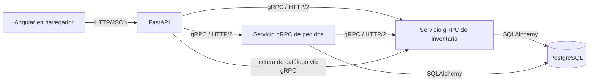
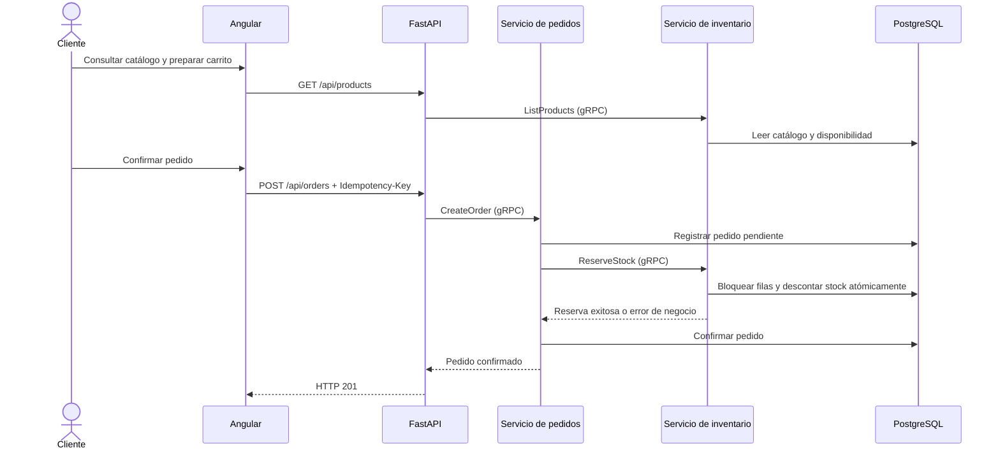

# Arquitectura y decisiones

## Problema y alcance

ShopPasto representa una tienda académica para practicar pedidos y control de existencias en un contexto colombiano. El MVP permite explorar productos, filtrar, añadir cantidades al carrito, crear y consultar pedidos, y cancelar pedidos para liberar inventario. No procesa pagos, no usa usuarios reales y no integra cuentas externas.

## Componentes

PostgreSQL es una sola instancia local compartida. Inventario es responsable de productos, existencias y reservas; pedidos es responsable de pedidos y sus líneas. Esto no representa aislamiento de bases de datos por microservicio.

## Recorrido de compra

## Consistencia y fallos parciales

La reserva usa transacciones SQL y bloqueos de fila para que dos solicitudes no descuenten las mismas unidades. El identificador del pedido hace idempotente la reserva. El pedido se registra primero como pendiente; si el servicio de inventario no responde, permanece pendiente y el mismo `Idempotency-Key` puede reintentar la operación. Si la reserva se rechaza por una regla de negocio, el pedido se cancela. La cancelación del pedido libera la reserva de forma idempotente.

Pedidos e inventario no participan en una transacción distribuida. Si un servicio cae entre operaciones, el estado pendiente permite reintentar; no se promete atomicidad global instantánea. El despliegue de producción necesitaría supervisión y una estrategia explícita para reservas pendientes antes de ampliar el tráfico.

## gRPC, HTTP/2 y Protocol Buffers

Los `.proto` definen los mensajes versionables y los métodos RPC. `grpcio-tools` genera stubs cliente/servidor; el tráfico entre procesos es gRPC sobre HTTP/2. El frontend usa HTTP/JSON con FastAPI porque el navegador no habla gRPC convencional directamente.

## Decisiones de tecnología

- Se usa Angular, no React, por requisito del taller.
- FastAPI concentra el contrato REST y actúa como cliente gRPC; no se añade otro API Gateway.
- Se usa PostgreSQL, SQLAlchemy y Alembic; no se añaden colas, cachés ni bases de datos extra.
- Los dos servicios gRPC son procesos separados, aunque comparten una instancia PostgreSQL local con tablas de propiedad claramente delimitada.
- No se implementan pagos, autenticación, infraestructura paga ni un despliegue automático.

## Requisitos funcionales principales

1. Consultar, buscar y filtrar productos disponibles.
2. Preparar un carrito con cantidades y total en pesos colombianos.
3. Crear un pedido persistido con clave idempotente.
4. Reservar stock mediante gRPC entre dos procesos.
5. Consultar pedidos por identificador o correo.
6. Cancelar un pedido confirmado y devolver sus unidades al inventario.

## Limitaciones

- El MVP no tiene cuentas ni autorización administrativa; no debe exponerse como panel de administración público.
- El correo se usa únicamente para buscar pedidos de demostración.
- El entorno Compose es local; TLS, secretos gestionados, disponibilidad y plataforma de nube quedan pendientes.
- Una sola instancia PostgreSQL simplifica el taller, pero no aísla datos entre servicios.
